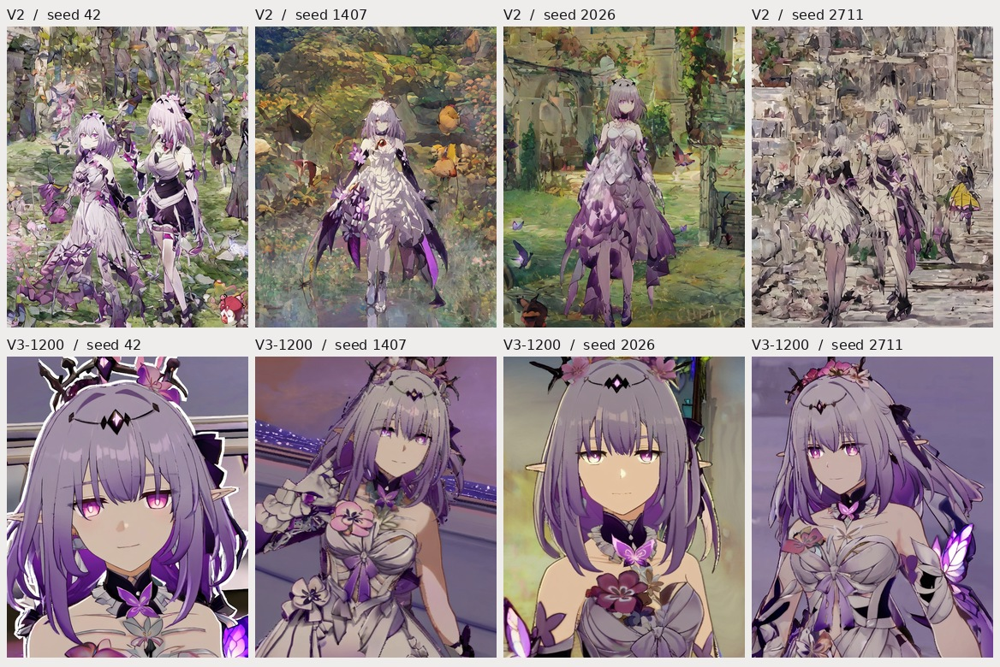

# 遐蝶（Castorice）角色 LoRA

用 ComfyUI 生成《崩坏：星穹铁道》遐蝶的原服形象。两版共用触发词 `cstriceHSR`。第一次尝试、想看清花冠和五官，可以从 V3 开始。如果已有 Anything V5 PrtRE 环境，可以直接使用 V2。

## 版本与下载

| 版本 | 配套底模 | 只写触发词时的表现 | Release |
| --- | --- | --- | --- |
| V2 · 1,950 步 | [Anything V5 PrtRE（SD 1.5）][base-v2] | 在下方对比中多为全身或较远景别，能看到裙摆和环境，部分种子会出现额外人物。V2 发布时的测试尺寸为 512 × 640。 | [V2 Release][release-v2] · [下载 LoRA][lora-v2] |
| V3 · 1,200 步 | [NoobAI-XL 1.1（SDXL，epsilon 版）][base-v3] | 使用 20 张筛选后的单人原服裁切图训练。四个种子均为单人近景或半身，额前菱形饰件和白紫色胸饰更清楚，部分构图会裁到花冠顶部。工作流默认 768 × 960。 | [V3 Release][release-v3] · [下载 LoRA][lora-v3] |

两版使用不同架构，请将每个 LoRA 与同一行的底模配对。V2 底模随 GitHub Release 提供，V3 底模从 Hugging Face 下载。

## 在 ComfyUI 中运行 V3

1. 下载下表中的三个文件。模型目录以当前 ComfyUI 使用的数据目录为准，保留下载时的模型文件名，工作流就能按名称找到它们。

   | 文件 | 放置位置 |
   | --- | --- |
   | [NoobAI-XL-v1.1.safetensors][base-v3]（底模，约 7.11 GB） | `ComfyUI/models/checkpoints/` |
   | [Castorice-v3-NoobAI-XL-step00001200.safetensors][lora-v3]（角色 LoRA） | `ComfyUI/models/loras/` |
   | [Castorice-v3-ComfyUI.json][workflow-v3]（工作流） | 可放在“下载”文件夹，下一步从这里拖入 |

2. 打开 ComfyUI，把下载的 `Castorice-v3-ComfyUI.json` 拖到画布上。在底模加载节点和 LoRA 加载节点中，核对所选文件名与上表一致。如果下拉列表里找不到文件，重启 ComfyUI 后重新打开工作流。
3. 正向提示词只写 `cstriceHSR`，负向留空，LoRA 强度保持 `1.0`。点击 **运行（Run）** 即可生成种子 `42` 的图。默认输出目录为 `ComfyUI/output/Castorice-v3/`。
4. 要复现其余三列，在 `KSampler` 节点把 `seed` 依次改为 `1407`、`2026`、`2711`，每改一次运行一次。保持种子模式为 `fixed`，沿用工作流的 24 步、CFG 6.5、`dpmpp_2m` 采样器和 `karras` 调度器。

## 四个种子的 V2 / V3 对比

上排是 **V2 + Anything V5 PrtRE**，下排是 **V3（1,200 步）+ NoobAI-XL 1.1**。从左到右依次为 `42`、`1407`、`2026`、`2711`。为了按列比较，两排都用 **768 × 960**，正向只写 `cstriceHSR`，负向留空，采样设置相同。

看花冠和原服上身细节可以先看最右列的 `2711`。V2 在这个种子下出现了两个人物，V3 则能同时看到花冠、额饰和胸前的蝴蝶结。[下载对比原图][comparison]

[release-v2]: https://github.com/weixinzq/Castorice/releases/tag/v2-sd15
[base-v2]: https://github.com/weixinzq/Castorice/releases/download/v2-sd15/anything-v5-PrtRE.safetensors
[lora-v2]: https://github.com/weixinzq/Castorice/releases/download/v2-sd15/Castorice-v2-final-SD15_1950_steps_00001_.safetensors
[release-v3]: https://github.com/weixinzq/Castorice/releases/tag/v3-noobai-xl
[base-v3]: https://huggingface.co/Laxhar/noobai-XL-1.1/resolve/814a274af2b8097c0828819d561ec74c7d0c6cea/NoobAI-XL-v1.1.safetensors?download=true
[lora-v3]: https://github.com/weixinzq/Castorice/releases/download/v3-noobai-xl/Castorice-v3-NoobAI-XL-step00001200.safetensors
[workflow-v3]: https://github.com/weixinzq/Castorice/releases/download/v3-noobai-xl/Castorice-v3-ComfyUI.json
[comparison]: https://github.com/weixinzq/Castorice/releases/download/v3-noobai-xl/comparison.jpg
